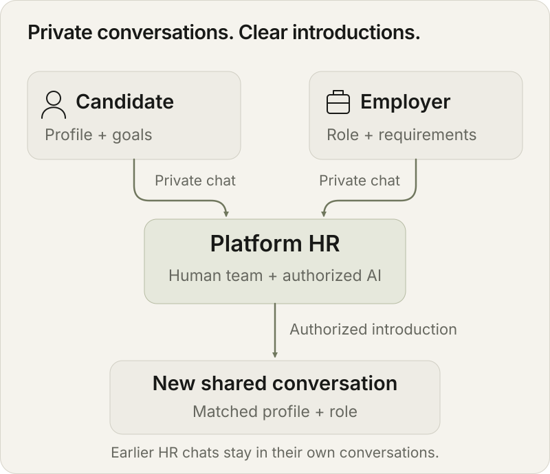
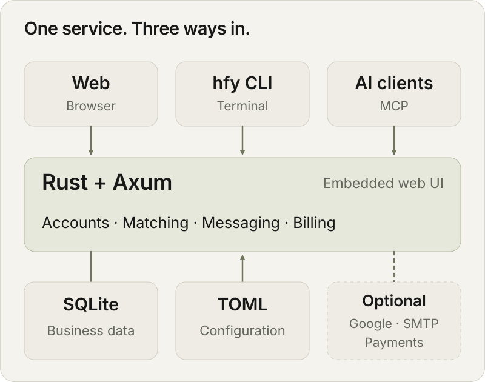

<p align="center">
  
</p>

<h1 align="center">聘渡 · HireFerry</h1>

<p align="center">人类 HR 与 AI 协作，让人才与机会相遇。</p>

<p align="center">
  <strong>简体中文</strong> ·
  <a href="docs/i18n/README.en.md">English</a> ·
  <a href="docs/i18n/README.zh-TW.md">繁體中文</a>
</p>

<p align="center">
  <a href="https://github.com/TokenNotIncluded/hireferry/actions/workflows/ci.yml"></a>
  <a href="https://github.com/TokenNotIncluded/hireferry/actions/workflows/cli-release.yml"></a>
  <a href="https://github.com/TokenNotIncluded/hireferry/releases/latest"></a>
  <a href="LICENSE"></a>
  <a href="Cargo.toml"></a>
  <a href="docs/self-hosting.md"></a>
</p>

<p align="center">
  <a href="https://hireferry.lmm.best">官网</a> ·
  <a href="docs/README.md">文档</a> ·
  <a href="docs/downloads.md">下载桌面版 / CLI</a> ·
  <a href="https://github.com/TokenNotIncluded/hireferry/issues">问题反馈</a>
</p>

聘渡是一个可自托管的人才匹配平台。求职者和招聘方分别与平台沟通，由人类 HR 与已授权的 AI 整理需求、建立介绍、跟进进展。双方在匹配后查看对应资料，并进入独立会话。

服务端使用 **Rust + Axum + SQLite**。一个二进制内嵌网页，TOML 管理配置。求职者免费，招聘方费用按站点配置收取。

**本页导航**：[桌面下载](#desktop) · [功能](#features) · [服务流程](#workflow) · [快速开始](#quick-start) · [CLI 与 AI](#cli-and-ai) · [系统架构](#architecture) · [文档](#documentation) · [参与贡献](#contributing)

<a id="features"></a>

## 功能

| 面向谁 | 可以做什么 |
| --- | --- |
| 求职者 | 管理简历与求职委托、联系平台、查看介绍和外部寻找进展 |
| 招聘方 | 发布岗位、维护招聘人数、管理订单与优惠、跟进候选人 |
| HR 团队 | 按岗位筛选候选人、建立介绍、推进面试与录用；超级管理员可[邀请团队经理](docs/staff.md)，或[添加具有业务权限的真人及 AI 员工](docs/team.md) |
| AI 助手 | 通过 MCP、HumanGrant 或受支持浏览器的 WebMCP 使用获授权功能 |
| 自托管运营者 | 配置币种与费用、邮件与支付、业务限额、Webhook 和备份 |

网页提供简体中文与英文，支持浅色、深色和跟随系统。README 提供简体中文、English 和繁體中文。

<a id="workflow"></a>

## 服务流程



1. **提交需求**：求职者填写资料和委托，招聘方创建岗位。
2. **平台介绍**：HR 按岗位筛选，并将合适的候选人介绍给招聘方。
3. **共同推进**：双方在新会话中沟通，平台跟进面试与录用。

资料面向平台及具体匹配对象开放。此前与平台的私聊保留在原会话中。外部联系由求职者另行授权。

[产品与业务规则 →](docs/product.md)

<a id="quick-start"></a>

## 快速开始

### 使用已部署的服务

打开 [hireferry.lmm.best](https://hireferry.lmm.best)，使用 Google 或邮箱验证码登录。选择求职者或招聘方后进入工作台。

### 本地开发

使用 Rust **1.99.1**，与[当前 CI](.github/workflows/ci.yml) 一致。Linux 需要 C 工具链、`pkg-config` 与 OpenSSL 开发包。

<details>
<summary>Debian / Ubuntu 构建依赖</summary>

```sh
sudo apt-get update
sudo apt-get install -y build-essential pkg-config libssl-dev ca-certificates
```

</details>

```sh
git clone https://github.com/TokenNotIncluded/hireferry.git
cd hireferry
cp config.development.toml config.toml
chmod 600 config.toml
cargo run --locked -- --config config.toml serve
```

打开 **http://localhost:3000**。开发配置仅监听本机，邮箱验证码显示在页面中。Google、SMTP 和支付网关按需配置。

生产部署使用 [config.example.toml](config.example.toml)。systemd、Caddy、Docker、管理员初始化与备份见[自托管指南](docs/self-hosting.md)。

<a id="desktop"></a>

## 桌面版与 CLI 下载


Tauri 2 桌面版复用系统 WebView，连接官方或自托管站点。Windows 提供 NSIS / MSI，macOS 提供 DMG，Linux 提供 deb、rpm、AppImage 和 Flatpak；`hfy` 用户 CLI 独立打包。文档由同一份发布目录自动生成，成功发布后展示实际包版本、大小与下载链接。

**[下载矩阵 →](docs/downloads.md)** · [桌面安装与发行版兼容说明](docs/desktop.md) · [发布工作流](.github/workflows/desktop-release.yml)

<a id="cli-and-ai"></a>

## CLI 与 AI

### 安装 `hfy`

Arch Linux 可用 `yay -S hireferry-cli-bin`，开发版用 `hireferry-cli-git`。自托管服务端单独安装 `hireferry-server-bin` 或 `hireferry-server-git`，详见 [AUR 指南](docs/aur.md)。

Linux / macOS：

```sh
curl -fsSL https://hireferry.lmm.best/install.sh | sh
```

Windows PowerShell：

```powershell
irm https://hireferry.lmm.best/install.ps1 | iex
```

安装器识别 x64 / ARM64，校验 SHA-256 并安装到用户目录。重复运行即可升级。

```sh
hfy auth login
hfy whoami
hfy capabilities --json
```

远程终端使用 `hfy auth login --device`。配置、授权范围、升级与卸载见 [CLI 指南](docs/cli.md)。

网页支持快速反馈，当前源码版 `hfy` 也可提交。管理员通过 CLI 或 MCP 处理，保留期限与容量可配置。安装方式与操作见[反馈指南](docs/feedback-and-retention.md)。

### 接入 AI

| 方式 | 用途 | 文档 |
| --- | --- | --- |
| MCP | 通过 `/mcp` 使用账户获授权的工具 | [API 与 MCP](docs/api.md) |
| HumanGrant | 由本人选择权限和期限，AI 使用独立签名凭据 | [HumanGrant](docs/humangrant.md) |
| WebMCP | 在支持该接口的浏览器中使用当前会话权限 | [API 与 MCP](docs/api.md) |
| Agent Skill | 为助手安装 `hfy` 使用说明 | [CLI 与技能](docs/cli.md#安装升级与移除-agent-skill) |

```sh
npx skills add TokenNotIncluded/hireferry --skill hireferry
```

技能安装需要 Node.js 22.20+。Windows PowerShell 可用 `npx.cmd`。AI 模型、外部搜索和外联工具由运营者另行接入。

<a id="architecture"></a>

## 系统架构



| 层次 | 实现 |
| --- | --- |
| 访问入口 | 网页、`hfy`、MCP、浏览器 WebMCP |
| 应用服务 | Rust / Axum、内嵌静态资源、统一业务权限 |
| 数据与配置 | SQLite、TOML、在线备份 |
| 可选集成 | Google 登录、SMTP、Stripe、Waffo、用户 Webhook |

生产运行无需 Node.js 服务或独立数据库服务。币种、价格、限额与集成参数在 TOML 中配置。

<a id="documentation"></a>

## 文档

| 想了解什么 | 从这里开始 |
| --- | --- |
| 产品流程、隐私和收费 | [产品概览](docs/product.md) · [岗位规则](docs/jobs.md) |
| CLI 安装与账户连接 | [CLI 指南](docs/cli.md) |
| AI 授权与接口 | [身份认证](docs/auth.md) · [HumanGrant](docs/humangrant.md) · [API / MCP](docs/api.md) |
| 支付、优惠与事件通知 | [支付](docs/payments.md) · [优惠码](docs/promo-codes.md) · [Webhook](docs/webhooks.md) |
| 快速反馈与数据维护 | [反馈与增长控制](docs/feedback-and-retention.md) |
| 部署、配置和维护 | [自托管](docs/self-hosting.md) · [部署交接](docs/deployment-handoff.md) |
| 测试结果与后续工作 | [验收记录](docs/acceptance.md) · [待完成事项](docs/remaining-work.md) |

[完整文档目录 →](docs/README.md) · [English](docs/i18n/README.en.md) · [繁體中文](docs/i18n/README.zh-TW.md)

专题文档目前以简体中文为主。各语言 README 使用相同章节和命令，新增语言见[翻译说明](docs/i18n/README.md)。

<a id="contributing"></a>

## 参与贡献

欢迎提交问题、代码、文档与翻译。修改代码后运行对应检查：

```sh
cargo fmt --all -- --check
cargo test --locked --workspace
for suite in tests/*.test.mjs; do node "$suite" || exit 1; done
python3 tests/cli-scripts.test.py
```

前端检查使用 Node.js 24。完整验证步骤见[自托管指南](docs/self-hosting.md)，现有记录见[验收文档](docs/acceptance.md)。

## 许可与致谢

采用 [AGPL-3.0-or-later](LICENSE)。

首页粒子运行时来自 [particle-sculpture-skill](https://github.com/LIghtJUNction/particle-sculpture-skill)。主题颜色使用 [Material Color Utilities](https://github.com/material-foundation/material-color-utilities)，界面视觉参考 [ix.dev](https://ix.dev/)。版权与依赖说明见 [THIRD_PARTY_NOTICES](THIRD_PARTY_NOTICES) 和[粒子运行时声明](static/runtime/NOTICE)。
