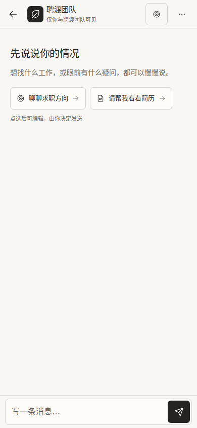
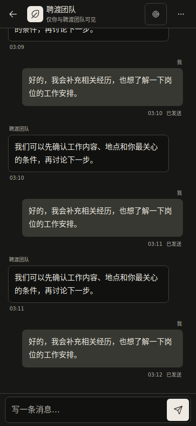
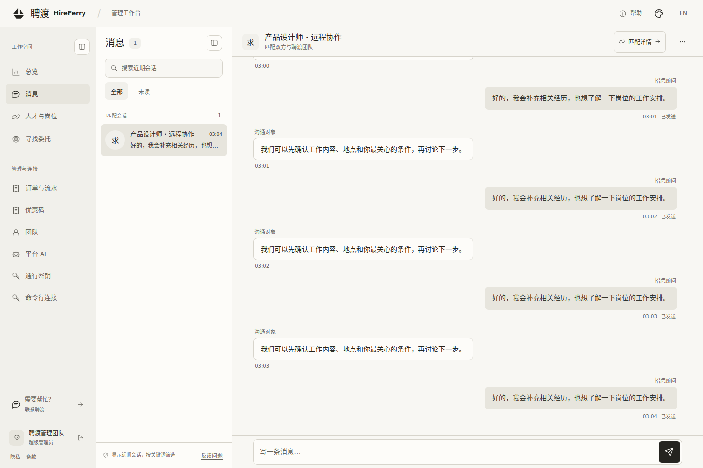

# 紧凑、稳定的聊天界面

更新：2026-10-22 UTC。基线：`4393a467aa91ed0124c6fcbba5e9734ced75e55e`。

本次调整面向求职者、招聘者与管理员的消息页面：减少固定区域、保留阅读位置，让状态与实际发送结果一致。验证使用真实前端资源与合成接口数据；截图中没有真实用户信息。

## 布局与文案

手机进入会话后，只显示紧凑的会话标题、消息区和输入框。返回列表会恢复站点顶部和工作台导航。隐私说明、反馈与快捷键说明进入会话菜单；反馈浮标在存在替代入口时才隐藏，因此加载失败页面仍可反馈。

输入框初始为单行，随内容增长并限制最大高度。标题、消息区和输入区使用连续底色、清晰边线和较小圆角。去掉独立隐私横条、常驻“消息已同步”页脚和大面积欢迎装饰。招聘账户的开通说明折叠在消息滚动区内，不阻塞聊天或重复占用固定空间。

| 身份 | 欢迎标题 | 说明 |
| --- | --- | --- |
| 求职者 | 先说说你的情况 | 想找什么工作，或眼前有什么疑问，都可以慢慢说。 |
| 招聘者 | 一起理清招聘需求 | 岗位、要求和时间安排，可以逐步补充。 |
| 管理员 | 确认需求，明确下一步 | 核对当前沟通对象，确认需要跟进的事项。 |

建议话题只补充输入内容，不自动发送，也不覆盖正在写的草稿。

## 稳定性与状态

- 阅读历史时，新消息仅显示提示，不把页面强制拉到底；停留在底部时才继续跟随。
- 输入区增高、视口变小、返回列表后重新进入会话时，保留当前消息的阅读锚点。隐藏会话的零尺寸不会覆盖位置。
- 发送中的状态独立于历史轮询。发送失败后，成功读取历史不会误报发送成功；重试复用同一个客户端消息标识。
- 仅本人对应的服务端回执能确认发送。已确认消息标为“已发送”，不表示收件人已读。
- 草稿在当前页面会话间保留；没有新增跨刷新持久化或离线存储承诺。账号切换、撤权与迟到响应的隔离规则保持生效。
- 已归档会话重新开放后，副标题、输入提示与可发送状态同步恢复。
- 手机键盘适配同时使用动态视口与 `VisualViewport`；缩放时不将缩放操作误认为键盘展开。

## 验证

前端自动化执行：

```sh
node --test --test-isolation=none --test-reporter=tap tests/*.test.mjs
```

**306 项测试通过，0 失败。** `git diff --check` 通过。

浏览器回归脚本为 [chat-layout.browser.mjs](../tests/chat-layout.browser.mjs)。脚本通过浏览器请求拦截提供仓库静态资源和合成接口，不连接生产后端；支持复用已安装的 Playwright 与 Chromium：

```sh
PLAYWRIGHT_MODULE=/path/to/playwright/index.mjs \
BROWSER_EXECUTABLE=/path/to/chromium \
node tests/chat-layout.browser.mjs
```

可选 `FONTCONFIG_FILE` 提供字体配置，`CHAT_QA_OUT_DIR` 指定输出目录，`CHAT_QA_CASES` 以逗号分隔场景名用于定向复验。默认情况下执行全部场景。

**9 组浏览器场景和 1 组可见视口合成验证通过。** 已验证手机浅色与深色、320/360px 英文长标题、招聘账户开通说明与发送、桌面管理员、归档会话、反馈焦点往返、失败后轮询与重试，以及历史中部返回列表、收到消息后重新进入的阅读位置。结果见 [浏览器验证汇总](validation/steady-chat/result-final.json)。

可见视口合成验证保持布局视口高度 844px，只将 `VisualViewport.height` 改为 500px，确认页面高度和输入区底边均为 500px、消息区仍有 379px，并保留阅读锚点；再将缩放比例改为 2，确认移除可见视口的高度覆盖。这是新增分支的合成验证，不是真机键盘测试。

| 浏览器视口 | 会话标题 | 单行输入区 | 消息区 | 消息区占视口 |
| --- | ---: | ---: | ---: | ---: |
| 390 × 844 | 56px | 65px | 723px | 85.7% |
| 390 × 500 | 56px | 65px | 379px | 75.8% |

上述尺寸是合成 Chromium 场景中的 CSS 像素，不包含手机浏览器自身工具栏。没有横向溢出或未捕获页面错误。本次不涉及后端变更；浏览器验证不等同于生产联调或 iOS/Android 真机软键盘验收。

## 实际界面预览

### 手机初次会话



### 手机深色消息



### 管理员桌面会话



## 参考思路

- [Chatwoot 的会话工作台](https://www.chatwoot.com/hc/user-guide/articles/1677231493-lesson-2-dashboard-basics)：辅助信息可以折叠，主要区域围绕会话组织。
- [Element 的时间线实现说明](https://github.com/element-hq/element-web/blob/314f3662ca742516be1e550737bc60e1ba03056e/packages/shared-components/src/room/timeline/TimelineView/TimelineView.tsx)：使用阅读锚点处理历史插入，仅在末尾跟随新消息，并保持视口变化时的位置。
- [Zulip 的发送确认说明](https://zulip.com/help/verify-your-message-was-successfully-sent)：区分服务端收到消息与待确认、可重试状态。

本次借鉴交互原则，未复制这些项目的实现代码或引入其运行时依赖。
