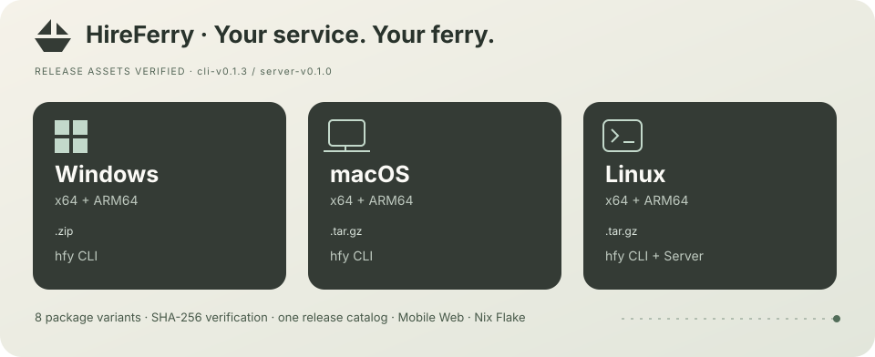

<!-- Generated by scripts/release.py; edit release/targets.json, not this file. -->
# 聘渡 · 桌面版、移动版、CLI、服务端与 Nix

[安装与发布说明](desktop.md) · [移动版说明](mobile.md) · [Nix 安装](nix.md) · [CLI 使用指南](cli.md) · [所有 Releases](https://github.com/TokenNotIncluded/hireferry/releases)

下表来自已汇总校验的发布资产；大小为实际下载体积，SHA-256 见对应 Release 的 `SHA256SUMS`。

**尚未收录已发布的桌面安装包。** 桌面构建目标见 `release/targets.json`。

- **hfy CLI 0.1.3**：[Release](https://github.com/TokenNotIncluded/hireferry/releases/tag/cli-v0.1.3) · [校验文件](https://github.com/TokenNotIncluded/hireferry/releases/download/cli-v0.1.3/SHA256SUMS)
- **服务端 0.1.0**：[Release](https://github.com/TokenNotIncluded/hireferry/releases/tag/server-v0.1.0) · [校验文件](https://github.com/TokenNotIncluded/hireferry/releases/download/server-v0.1.0/SHA256SUMS)

## 渠道矩阵

| 渠道 | 当前交付 | 入口 |
| --- | --- | --- |
| 移动版 Web（Android / iOS 浏览器） | 已提供响应式工作台；当前没有原生 APK / IPA | [打开移动版](https://hireferry.lmm.best/) · [说明](mobile.md) |
| Nix / NixOS | Flake 提供 `server` 与 `cli`，支持 x86_64-linux / aarch64-linux | [`github:TokenNotIncluded/hireferry`](nix.md) |
| 原生 Android / iOS | 当前没有可验证的正式安装包 | 继续使用移动版 Web |

## 已发布安装包

| 组件 | 系统 | 架构 | 软件包 | 下载体积 |
| --- | --- | --- | --- | --- |
| hfy CLI | Linux | ARM64 | [.tar.gz](https://github.com/TokenNotIncluded/hireferry/releases/download/cli-v0.1.3/hireferry-cli-0.1.3-aarch64-unknown-linux-musl.tar.gz) | 1.94 MiB |
| hfy CLI | Linux | x64 | [.tar.gz](https://github.com/TokenNotIncluded/hireferry/releases/download/cli-v0.1.3/hireferry-cli-0.1.3-x86_64-unknown-linux-musl.tar.gz) | 2.08 MiB |
| hfy CLI | Windows | ARM64 | [.zip](https://github.com/TokenNotIncluded/hireferry/releases/download/cli-v0.1.3/hireferry-cli-0.1.3-aarch64-pc-windows-msvc.zip) | 1.90 MiB |
| hfy CLI | Windows | x64 | [.zip](https://github.com/TokenNotIncluded/hireferry/releases/download/cli-v0.1.3/hireferry-cli-0.1.3-x86_64-pc-windows-msvc.zip) | 2.01 MiB |
| hfy CLI | macOS | ARM64 | [.tar.gz](https://github.com/TokenNotIncluded/hireferry/releases/download/cli-v0.1.3/hireferry-cli-0.1.3-aarch64-apple-darwin.tar.gz) | 1.83 MiB |
| hfy CLI | macOS | x64 | [.tar.gz](https://github.com/TokenNotIncluded/hireferry/releases/download/cli-v0.1.3/hireferry-cli-0.1.3-x86_64-apple-darwin.tar.gz) | 1.94 MiB |
| 服务端 | Linux | ARM64 | [.tar.gz](https://github.com/TokenNotIncluded/hireferry/releases/download/server-v0.1.0/hireferry-server-0.1.0-aarch64-unknown-linux-gnu.tar.gz) | 6.45 MiB |
| 服务端 | Linux | x64 | [.tar.gz](https://github.com/TokenNotIncluded/hireferry/releases/download/server-v0.1.0/hireferry-server-0.1.0-x86_64-unknown-linux-gnu.tar.gz) | 6.79 MiB |

## Arch Linux / AUR

服务端与客户端 CLI 独立安装，支持 x86_64 和 aarch64。同一组件的 `-git` 与 `-bin` 互斥，服务端与 CLI 可以共存。

| 组件 | 跟随 main 编译 | 安装 Release 二进制 |
| --- | --- | --- |
| 服务端 | [hireferry-server-git](https://aur.archlinux.org/packages/hireferry-server-git) | [hireferry-server-bin](https://aur.archlinux.org/packages/hireferry-server-bin) |
| hfy CLI | [hireferry-cli-git](https://aur.archlinux.org/packages/hireferry-cli-git) | [hireferry-cli-bin](https://aur.archlinux.org/packages/hireferry-cli-bin) |

安装、服务初始化与发布流程见 [AUR 指南](aur.md)。AUR 配方不计入上面的 Release 二进制数量。

## Linux 选包建议

| 发行版系列 | 桌面版优先选择 | 适用范围 |
| --- | --- | --- |
| Ubuntu、Debian、Linux Mint、Pop!_OS、Zorin、elementary | `.deb`；依赖不匹配时用 Flatpak | Ubuntu 22.04 / Debian 12 基线及提供 WebKitGTK 4.1 的后续版本 |
| Fedora、openSUSE、RHEL / Rocky / Alma 衍生版 | `.rpm`；缺少所需库时用 Flatpak | 安装器依赖检查通过的版本；旧企业版不承诺原生运行 |
| Arch、Manjaro、EndeavourOS、Gentoo | AppImage 或 Flatpak | AppImage 仍受宿主 glibc 与图形环境限制 |
| NixOS | Nix Flake 的 `server` / `cli`；桌面版可用 Flatpak | `nix profile install github:TokenNotIncluded/hireferry#cli`；桌面版仍需图形运行时 |
| 不可变桌面、SteamOS | Flatpak | 先配置发行版支持的 Flatpak 服务、运行时和桌面 portal |
| Alpine / musl 系统 | CLI 使用 musl 包；桌面优先 Flatpak | 原生 glibc 桌面包不适用；Flatpak 可用性取决于发行版配置 |

Linux CLI 的静态 musl 包可用于 glibc 与 musl 发行版；桌面版需要图形会话。Flatpak 首次安装共享运行时需要额外空间，后续应用可复用。

Windows 的 NSIS 包按需下载 WebView2；macOS 使用系统 WebKit。桌面版不附带服务器或数据库，业务页面连接所选 HireFerry 站点。

**兼容范围不是“所有历史发行版本均实测”。** 架构、运行时和系统依赖满足要求才适用；具体要求、安装命令与签名说明见 [桌面版文档](desktop.md)。

维护者：`release/targets.json` 同时定义二进制目标和移动 Web / Nix 渠道；已发布下载表固定使用 `release/latest.json` 内的目录快照。桌面版、CLI 与服务端按各自的稳定版本更新，旧版本不会覆盖较新的产品条目；修改构建目标不会改写历史包。运行 `python3 scripts/release.py docs --check` 检查生成文件。
