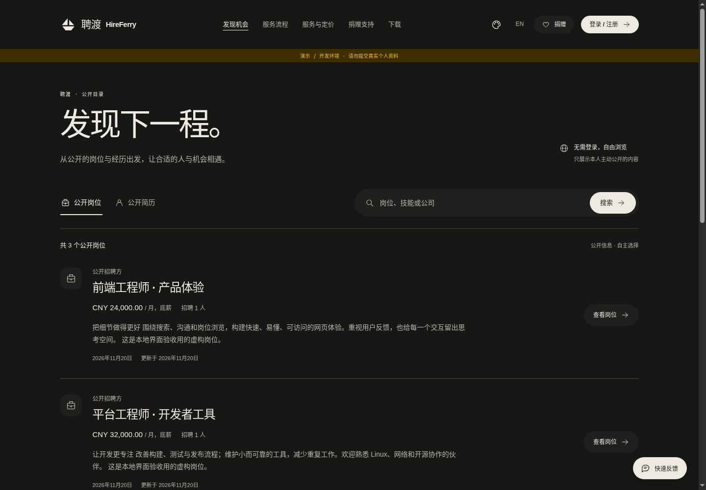
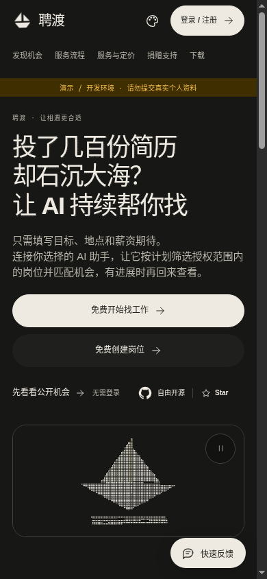
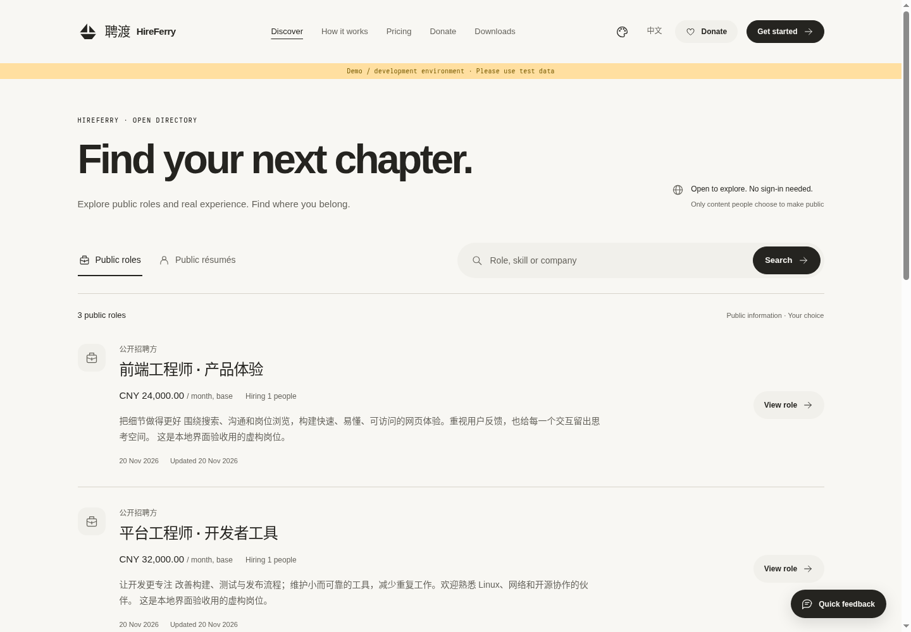

# HireFerry 体验迭代验收

日期：2026-11-20（Asia/Taipei）

本轮改进集中在首次浏览公开机会的完整路径：首页入口、公开目录、搜索与详情返回、登录状态恢复，以及手机上的阅读体验。代码在独立分支完成；截图来自隔离的本地预览，使用虚构岗位和简历。线上服务尚未部署本轮变更。

## 1. 页面与交互

公开目录改为留白更充足的列表。标题、招聘方、薪资和人数有清楚的层次，长摘要限制为三行，结果数量与清除搜索动作独立呈现。搜索框与按钮保持同一行，中文按钮不会挤成纵向文字。岗位和简历使用一致的导航与列表结构。

首页增加“先看看公开机会”的直接入口，并标明无需登录。当前页面在导航中有明确标识；手机导航可以横向滚动，链接点击区域至少为 44px。深色、浅色及中英文沿用现有主题和语言机制，没有增加运行时依赖。

搜索上下文沿浏览路径保留：切换岗位与简历时保留关键词并回到第一页；进入详情后返回目录时恢复原关键词和页码。公开内容已下架或不存在时，错误页也使用同样的返回规则。页面的 canonical 与分享地址仍保持干净。

## 2. 缺陷修复

| 问题 | 原因与改动 | 验证依据 |
|---|---|---|
| 已登录用户直接打开公开目录或详情，页头仍显示登录入口 | 动态公开路由未完整参加后台配置与会话刷新。现在覆盖目录、岗位详情、简历详情及公开个人主页；刷新页头时保留主内容节点、输入值与详情元数据。 | 路由回归测试；真实本地账号冷入口；人为延迟会话后仍保留输入的搜索词。 |
| 手机首页随普通页面滚动误切换章节 | 章节推进应依赖实际 sticky 布局和有效滚动距离。现在只在满足这些条件时启用，并在切换布局、减少动态效果或结束动画时取消待执行帧。 | 首页动效测试；390px 手机滚动保持第一章节；桌面正反向章节推进测试。 |
| 减少动态效果时仍有过长的首页滚动区 | 原来的章节容器高度继续为滚动叙事预留空间。现在减少动态效果时回到自然高度。 | 浏览器中容器与 hero 均为 652.23px，不再保留额外章节空白。 |
| 下载页面目录落后于已发布快照 | 基线的静态目录仍为 CLI 0.1.3，发布快照已为 0.1.4。生成器和发布文档工作流遗漏了静态目录。现在从既有已验证快照同步生成，并纳入一致性检查与提交清单。 | 原测试在基线复现失败；修后现有下载测试全部通过；静态目录与发布快照逐字节一致。 |

下载修复没有改变现有测试断言，也没有触发发布工作流或创建新版本。后续发布会由同一个已发布 manifest 同时更新文档与网页下载目录。

## 3. 验收结果

| 检查 | 结果 |
|---|---|
| 完整前端测试 `node --test tests/*.test.mjs` | 426 / 426 通过；0 失败、0 跳过。 |
| 既有发布目录 Python 测试 | 2 / 2 通过。 |
| `python3 scripts/release.py docs --check` | 通过。 |
| Rust 应用构建 `cargo build --locked --bin hireferry` | 通过；最终构建包含更新后的静态资源与下载目录。 |
| Chromium 页面及交互检查 | 17 项通过，覆盖 1440px 桌面、390px 与 320px 手机、英文浅色主题、减少动态效果、搜索、类别切换、详情返回和空结果恢复。 |
| Chromium 已登录冷入口与失效详情检查 | 5 项通过。 |
| `git diff --check` | 通过。 |

浏览器检查没有出现未处理的 JavaScript 异常。手机目录、简历列表与首页均未出现文档级横向溢出。测试覆盖 Chromium；本轮未单独验收 Safari 或 Firefox。

可复查的浏览器记录：[页面与交互](browser-report.json)、[登录与失效详情](public-session-browser-report.json)。

发布目录的针对性测试命令：

```sh
python3 tests/release.test.py \\
  ReleaseTests.test_published_catalog_survives_new_planned_formats_and_targets \\
  ReleaseTests.test_cli_first_then_desktop_keeps_newer_cli_and_frozen_catalog
python3 scripts/release.py docs --check
```

## 4. 界面截图

截图保留开发环境横幅；其中的岗位、薪资与个人资料仅用于界面验收，不代表真实招聘信息。

### 桌面 · 深色公开目录



### 手机 · 首页



### 桌面 · 英文浅色公开目录



[查看手机公开目录完整长图](directory-mobile-dark.png)

## 5. 提交与范围

分支：`improve/hireferry-experience-20261120`。

- [ee0224c — 恢复公开页会话与稳定手机首页动效](https://github.com/TokenNotIncluded/hireferry/commit/ee0224c57d286a955f081a8ba21986a40416f365)
- [37b3cb3 — 优化公开目录与保留搜索上下文](https://github.com/TokenNotIncluded/hireferry/commit/37b3cb33a14b258395b0c013f4805a9ac954e9d9)
- [9ea4d23 — 同步网页下载目录与发布快照](https://github.com/TokenNotIncluded/hireferry/commit/9ea4d2382e6ea8660976316b4aff2ab24b5b4a95)

工作基于远端主分支的独立工作区完成。原工作区已有的后端改动保持原样。本轮未修改生产数据库、支付配置或部署服务；变更以分支和 Pull Request 交付供合并与发布。
